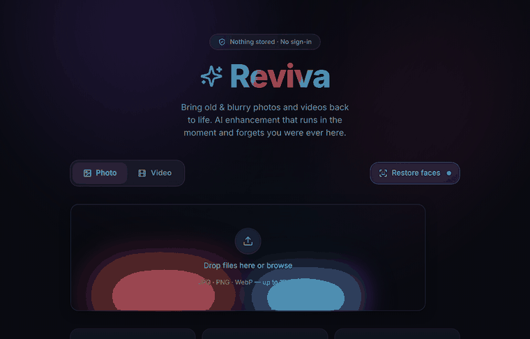

<div align="center">

# ✨ Reviva

### Bring old &amp; blurry photos and videos back to life — AI photo &amp; video enhancer



**No database · No sign-in · Nothing stored**

[](LICENSE)


</div>

---
deployment:https://huggingface.co/spaces/codewithyeasin/reviva
> **What it is:** a Remini‑style web app — upload a blurry or low‑resolution
> photo (or a short video) and get a sharper, restored version back. It runs on
> open‑source AI models. It is an **independent open‑source project** and is not
> affiliated with, endorsed by, or connected to any commercial app.

## Why another one?

Most "photo enhancer" apps make you sign up and quietly keep your uploads on
their servers. Reviva flips that: it does the enhancement and then **forgets you
were ever there.** No account. No database. Your file lives only in memory for
the few seconds it takes to process, then it is shredded.

## Features

- 📷 **Photo enhance** — face restoration + upscaling (GFPGAN + Real‑ESRGAN)
- 🎬 **Video enhance** — frame‑by‑frame enhancement for short clips
- 🔍 **Before / after slider** to see exactly what changed
- 🔒 **No‑retention by design** — in‑memory processing, instant cleanup
- 🚫 **No accounts, no database, no content logging**
- 🧱 Rate limiting, strict upload validation, security headers out of the box

## How privacy actually works

```
Browser ──upload──▶  Backend (RAM temp dir)  ──▶  AI model (GPU)
                          │                           │
   result ◀──stream──── enhance ◀────────────────────┘
                          │
                     shred temp  (nothing left on disk)
```

- Files are validated by **magic bytes**, not just the filename.
- Processing happens in a RAM‑backed directory (`/dev/shm`) when available.
- The temp directory is deleted the instant the response finishes streaming.
- Responses are sent with `Cache-Control: no-store` so proxies/CDNs can't keep a copy.

> **Honest limit:** heavy AI models can't run inside the browser, so files *are*
> sent to the server to be processed. The guarantee Reviva makes is
> **no retention** — nothing is kept after your request. That's the strongest
> practical privacy for this kind of tool.

## Quick start

> You need **Python 3.10+**, **Node.js 18+** (for the UI), **ffmpeg** (for video),
> and ideally an **NVIDIA GPU**. CPU works but is slow.

```bash
git clone https://github.com/<your-username>/reviva.git
cd reviva

# 1. Backend
python -m venv .venv && source .venv/bin/activate
# On a GPU box, install the CUDA build of torch FIRST:
#   pip install torch torchvision --index-url https://download.pytorch.org/whl/cu121
pip install -r requirements.txt

# 2. Everything (builds the frontend the first time, then serves API + UI)
bash run.sh          # → http://localhost:8000
```

`run.sh` builds the React frontend on first run and then one FastAPI process
serves both the API and the compiled UI on port 8000.

The **first** photo is slow because the model weights (~400 MB) download on
first use into `weights/`. Every request after that is fast.

### Frontend dev mode (hot reload)

The UI is **React + Vite + Tailwind**. For live editing, run the backend and the
Vite dev server side by side (Vite proxies `/api` to the backend):

```bash
# terminal 1 — backend
uvicorn backend.main:app --reload

# terminal 2 — frontend with hot reload
cd frontend && npm install && npm run dev   # → http://localhost:5173
```

The drag-and-drop zone is the open-source **Halo Dropzone** component from
[21st.dev](https://21st.dev) (cult-ui); the rest of the interface
(glassmorphism, aurora glow, before/after slider, motion) is custom.

### Run with Docker (optional)

```bash
docker build -t reviva .
docker run --gpus all -p 8000:8000 reviva
```

## Configuration

Everything is tuned with environment variables (see `backend/config.py`):

| Variable | Default | Meaning |
|---|---|---|
| `MAX_IMAGE_BYTES` | 15 MB | max photo size |
| `MAX_VIDEO_BYTES` | 60 MB | max video size |
| `MAX_VIDEO_SECONDS` | 15 | reject clips longer than this |
| `UPSCALE` | 2 | output scale factor (2 or 4) |
| `RATE_LIMIT_PHOTO` | 20/minute | per‑IP photo limit |
| `RATE_LIMIT_VIDEO` | 4/minute | per‑IP video limit |
| `ALLOWED_ORIGINS` | `*` | CORS — **set this to your domain in production** |
| `REVIVA_USE_GPU` | auto | `auto` / `1` / `0` |

## Project layout

```
reviva/
├── backend/
│   ├── main.py        # FastAPI app + routes
│   ├── enhance.py     # photo pipeline (GFPGAN + Real-ESRGAN)
│   ├── video.py       # video pipeline (ffmpeg + per-frame enhance)
│   ├── security.py    # validation, ephemeral storage, headers
│   └── config.py      # all tunable limits
├── frontend/          # React + Vite + Tailwind UI
│   ├── src/
│   │   ├── App.tsx            # futuristic glass UI, mode toggle, states
│   │   ├── components/
│   │   │   ├── BeforeAfter.tsx    # draggable comparison slider
│   │   │   └── ui/halo-dropzone.tsx  # 21st.dev glowing dropzone
│   │   ├── lib/utils.ts
│   │   ├── index.css         # design tokens, glass, aurora
│   │   └── main.tsx
│   ├── tailwind.config.js
│   └── vite.config.ts
├── docs/demo.gif
├── requirements.txt
└── run.sh
```

## Roadmap

- [ ] Background job + queue for longer videos
- [ ] Optional 4x / anime models
- [ ] WebGPU path so *tiny* images never leave the browser at all
- [ ] Batch photo mode

## Models &amp; credits

Reviva is a thin, privacy‑first wrapper around excellent open‑source work:

- [GFPGAN](https://github.com/TencentARC/GFPGAN) — face restoration
- [Real‑ESRGAN](https://github.com/xinntao/Real-ESRGAN) — super‑resolution
- [Halo Dropzone](https://21st.dev/@cult-ui/components/halo-dropzone) (cult-ui, via 21st.dev) — the animated upload zone

Please respect each model's and component's own license.

## ⚖️ Legal &amp; disclaimer

- **Reviva is an independent project.** It is **not** Remini and is not
  affiliated with, sponsored by, or endorsed by any commercial product or
  company. Any resemblance in purpose is because both solve the same common
  need (enhancing photos), not because any code or asset was copied.
- No proprietary code, model, or trademark of any other product is used.
- Enhancement is powered entirely by openly licensed models (links above).
- **You are responsible for what you upload.** Only process images and videos
  you own or have permission to use. Do not use Reviva to misrepresent people
  or create misleading content.
- Provided "as is" under the MIT License, with no warranty.

## License

[MIT](LICENSE) © 2026 Reviva contributors
